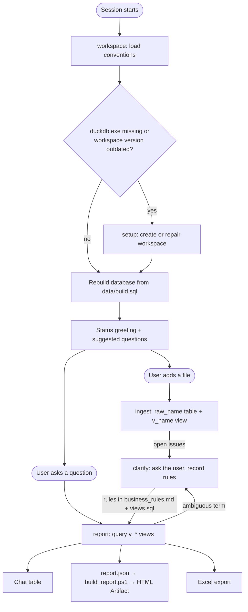

# `(˙●˙)` Minivakond

A Claude Code plugin that lets non-technical business users ask plain-language questions about their CSV and Excel files. It targets Hungarian users and runs on Windows only.

## What it does

- **Loads spreadsheets** into a local [DuckDB](https://duckdb.org/) database. It handles Hungarian CSV quirks: cp1250 encoding, `;` separators, decimal commas and `YYYY.MM.DD.` dates.
- **Clarifies the data** with the user: which column is the real measure, which rows count, which date to use. Each answer is saved as a numbered business rule and applied to every later answer.
- **Answers questions** with chat tables, HTML charts and reports (published as Artifacts), and Excel exports. Every number comes from a query that was actually run, and every answer lists the assumptions it made.

Example (in Hungarian, as the user would see it):

> **User:** Mennyi volt a forgalom júliusban régiónként?
>
> **Claude:** Júliusban a teljes nettó forgalom 124 000 000 Ft volt, ebből a Közép-Magyarország régió 41%-ot hozott. *(table)*
>
> **Feltételezések:** a sztornózott számlák nem számítanak bele (R-002).

## Install and use

1. Download the latest `minivakond-<version>.plugin` from [Releases](../../releases).
2. In the Claude desktop app, open **Customize > Plugins > Add > Upload plugin** and select the file. If the upload is rejected, rename the file to `.zip`; the format is the same.
3. Open an empty folder in the **Code** tab and say *„állítsd be”* ("set it up"). Setup creates the workspace and downloads DuckDB.
4. Drop a spreadsheet into `inbox/` (or attach it) and start asking questions.

## How it works



1. **Session start.** The `workspace` skill loads first in every session. If `tools/duckdb.exe` is missing or the workspace's version marker differs from the plugin version, it runs `setup`. It then rebuilds the database and greets the user with the loaded datasets, rule count, open questions, recent answers and new files in `inbox/`.
2. **New file.** `ingest` copies the file into `data/raw/` (never modified afterwards), loads it into a `raw_<name>` table and creates a `v_<name>` view. It records the original column headers and hands open questions to `clarify`.
3. **Ambiguity.** `clarify` looks for problems in the data itself, asks the user with concrete choices, and records each answer twice: as a human-readable rule (`R-001`, …) in `rules/business_rules.md`, and as SQL in `rules/views.sql`.
4. **Question.** `report` queries only the `v_*` views, so every answer applies the agreed rules. It picks the lightest output that fits: a chat table, a chart page, a full report page or an Excel file. It logs every answer in `reports/log.md`.

## Architecture

### Repository layout

```
plugin/                          everything that ships
  .claude-plugin/plugin.json     manifest; "version" drives workspace upgrades
  skills/
    workspace/                   conventions, session-start routine, golden rules
    setup/
      setup.ps1                  creates or repairs a workspace
      assets/                    workspace template copied into the user's folder
    ingest/                      file loading
    clarify/                     business rules
    report/
      spec.md                    report.json format
scripts/build.ps1                packages plugin/ into dist/minivakond-<version>.plugin
.github/workflows/release.yml    builds and publishes a GitHub Release on a v* tag
.claude/skills/                  dev-only skills for this repo (create-issue, open-pr, release)
```

### Skills

| Skill | Role | Triggers |
|---|---|---|
| `workspace` | Conventions, session-start routine, golden rules. Every other skill loads it first. | Any session in a folder with `.claude/minivakond-version` |
| `setup` | Creates or repairs a workspace: folders, starter files, helper scripts, DuckDB. Safe to re-run. | First run, missing tools, outdated version, "nem működik" |
| `ingest` | Loads a CSV or Excel file into a `raw_<name>` table and a `v_<name>` view. | New file in `inbox/`, attached or mentioned |
| `clarify` | Finds ambiguities in the data and records the answers as business rules. | Ambiguity that changes an answer, "nézzük át a szabályokat" |
| `report` | Answers questions with tables, charts, reports and Excel exports. | Any question about the data |

### Workspace

A workspace is the user's folder, marked by `.claude/minivakond-version`. Setup creates this layout:

```
CLAUDE.md                   pointer to the workspace skill
.claude/settings.json       permissions (data/raw/ is write-protected)
.claude/minivakond-version  workspace marker + plugin version
inbox/                      user drops new files here
data/raw/                   original files (read-only)
data/load.sql               loads each raw file into a raw_* table
data/build.sql              rebuilds everything: load.sql, then rules/views.sql
data/work.duckdb            the database; disposable, rebuilt every session
rules/business_rules.md     rules, glossary, data facts, open questions
rules/views.sql             the same rules as v_* views
reports/log.md              one line per answered question
reports/<date>_<slug>/      SQL files, notes.md, report.json + report.html / .xlsx
tools/                      duckdb.exe, helper scripts, report template
```

**File ownership.** User-owned starter files (`data/`, `rules/`, `reports/`, settings, `CLAUDE.md`) are created only when missing and never overwritten. Plugin-owned files (everything from `assets/tools/` and the version marker) are always refreshed.

**Upgrades.** When the marker differs from `version` in `plugin.json`, the next session re-runs setup. Bump the version whenever `assets/` or `tools/` change.

### Helper scripts

All live in `plugin/skills/setup/assets/tools/` and are copied into the workspace's `tools/`.

| Script | Purpose |
|---|---|
| `install_duckdb.ps1` | Downloads the latest DuckDB CLI into `tools/duckdb.exe`. |
| `copy_raw.ps1` | Copies a source file into `data/raw/`, which the Edit and Write tools can't touch. |
| `list_sheets.ps1` | Lists the sheet names of an `.xlsx` file (DuckDB can't). |
| `build_report.ps1` | Runs the SQL files named in `report.json` and renders `report.html` from `report_template.html`. No number is typed by hand. |

### Golden rules

- Every reported number comes from a query that was actually run.
- Files in `data/raw/` are never modified.
- Answers query `v_*` views only, never `raw_*` tables.
- Every user decision is recorded as a rule before it is used.
- Published pages contain only aggregated data, never row-level or personal data.

## Development

- **Build:** `powershell -File scripts/build.ps1` writes `dist/minivakond-<version>.plugin`.
- **Test:** there are no automated tests. Build, upload the plugin in the desktop app, and try it in an empty folder.
- **Release:** the `release` skill bumps `plugin.json` through a PR, then tags `main`. The tag triggers `release.yml`, which builds the plugin and publishes a GitHub Release. A version with a suffix (e.g. `0.2.0-rc.1`) is published as a prerelease.
- **Conventions:**
  - Conventional commits (`feat:`, `fix:`, `docs:`…) on feature branches.
  - Files are UTF-8 without BOM.
  - User-facing text is Hungarian; internal names are ASCII English snake_case.
- `CLAUDE.md` in the repo root is for developing this repo. The `CLAUDE.md.tmpl` in `assets/` is what goes into user workspaces.
